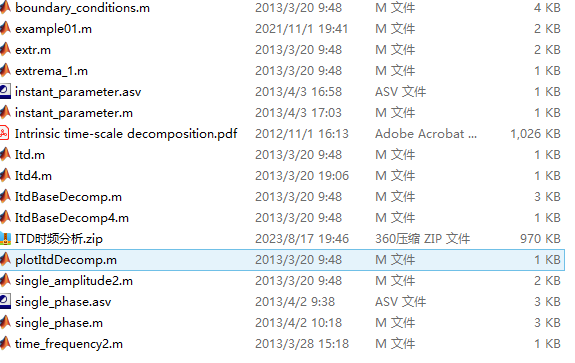

# [Time-Frequency Analysis]ITD Implicit Time Scale Decomposition: Time-frequency energy analysis of non-stationary signals and real-time filtering processing in MATLAB code

\n        \n  

## Images

<!-- PAYMENT_BLOCK -->

## Get this dataset

- Payment link (Stripe): [Buy now](https://buy.stripe.com/3cs8yP7sY87d0vu9AB)
- Payment QR code: 

<!-- /PAYMENT_BLOCK -->
